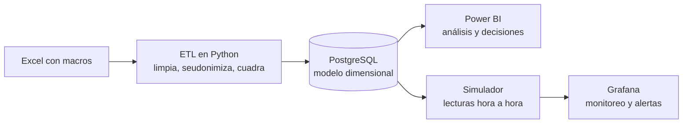

# BI de líneas de envasado de vinilos y témperas

Solución de inteligencia de negocios que lleva los registros históricos de producción y paros de un Excel con macros a un modelo dimensional en PostgreSQL, para calcular OEE, MTBF y MTTR y consumirlos en dos capas: un tablero analítico en **Power BI** para la dirección y un tablero operativo en **Grafana**, con alertas, para supervisión y mantenimiento.

Integrantes: Isaac Madera Jiménez y Daniela Montoya Quintero.

## Qué hace



- **Datos:** 8.208 filas del Excel (2022 a marzo de 2025) pasan por 26 reglas de limpieza documentadas y un cuadre de cifras; ningún nombre de persona llega a la base.
- **Modelo:** estrella con tres hechos (producción, paros, no operación) y ocho dimensiones, entre ellas una con SCD tipo 2.
- **Power BI:** proyecto PBIP con 31 medidas, inteligencia de tiempo, un Pareto y profundización por la jerarquía código → sistema → subcódigo.
- **Grafana:** tablero casi en tiempo real alimentado por un simulador calibrado con la historia, con tres reglas de alerta.

## Reproducir desde cero

Requisitos: Docker con Docker Compose y el archivo fuente, que no se versiona porque contiene datos personales.

```powershell
Copy-Item .env.example .env
```

Editar `.env` y reemplazar cada `cambiar_esto` por un valor propio. Para generar uno:

```powershell
python -c "import secrets; print(secrets.token_urlsafe(24))"
```

Colocar el Excel en `data/source/` con el nombre de `SOURCE_FILE`, y levantar todo con un solo comando:

```powershell
docker compose up -d
```

En unos 40 segundos quedan en marcha, en este orden:

| Servicio | Qué hace | Acceso |
|---|---|---|
| `db` | PostgreSQL 17; crea el usuario de solo lectura `bi_lector` | `localhost:5432` |
| `etl` | Crea los esquemas, limpia, seudonimiza, cuadra y carga; después termina | `docker compose logs etl` |
| `simulator` | Genera una hora de producción cada 15 s y recibe las alertas | interno |
| `grafana` | Tablero, fuente de datos y alertas ya cargados | `http://localhost:3000` |

Grafana entra con `GF_ADMIN_USER` y `GF_ADMIN_PASSWORD` del `.env`, y abre directo el tablero «Monitoreo de líneas de envasado». No hay nada que configurar a mano.

Para empezar de cero, incluida la base: `docker compose down -v`.

**Power BI y DBeaver** se ejecutan en el equipo anfitrión y se conectan a `localhost:5432`. DBeaver puede usar el usuario administrador del `.env`; Power BI usa `bi_lector`. Pasos en [docs/07_power_bi.md](docs/07_power_bi.md).

### Demostración de las alertas

Con el tablero abierto, ejecutar en DBeaver el guion [`sql/queries/30_demo_escenarios.sql`](sql/queries/30_demo_escenarios.sql). La primera sentencia que cambia es:

```sql
UPDATE ops.escenario SET modo = 'falla' WHERE maquina = 'Vinilos_2';
```

En unos 15 s la disponibilidad de Vinilos_2 cae y la alerta se dispara; con `modo = 'normal'` se resuelve.

### Pruebas automáticas

Sin necesidad de la base:

```powershell
docker compose run --rm --no-deps etl python -m pytest tests -q
docker compose run --rm --no-deps simulator python -m pytest tests -q
```

## Estructura

| Carpeta | Contenido |
|---|---|
| `etl/` | Proceso ETL en Python y sus pruebas |
| `sql/ddl/` | Tablas, restricciones, índices, vistas de indicadores y permisos |
| `sql/ops/` | Esquema de las lecturas hora a hora que usa Grafana |
| `sql/queries/` | 15 consultas de negocio (ventanas, comparativos entre periodos) y el guion de la demostración |
| `simulator/` | Simulador de lecturas hora a hora y receptor de alertas, con pruebas |
| `grafana/` | Provisioning (fuente de datos, tableros, alertas) y tablero exportado |
| `powerbi/` | Proyecto de Power BI en formato PBIP (modelo TMDL y reporte PBIR) |
| `db/init/` | Creación del usuario de solo lectura al iniciar la base |
| `docs/` | Análisis, indicadores, modelo, ETL, monitoreo, Power BI, arquitectura, seguridad y diccionario de datos |
| `data/source/` | Archivo fuente local, ignorado por Git |

## Documentación

1. [Análisis de negocio y diagnóstico](docs/01_analisis_negocio.md)
2. [Catálogo de indicadores](docs/02_catalogo_kpi.md)
3. [Modelo dimensional](docs/03_modelo_dimensional.md)
4. [Proceso ETL](docs/04_etl.md)
5. [Entrega del Bloque 1 al Bloque 2](docs/05_entrega_bloque_2.md)
6. [Monitoreo casi en tiempo real: simulador, Grafana y alertas](docs/06_monitoreo_grafana.md)
7. [Tablero analítico en Power BI](docs/07_power_bi.md)
8. [Arquitectura, comparación de capas y evolución hacia PLC o SCADA](docs/08_arquitectura_y_evolucion.md)
9. [Datos personales y seguridad de acceso](docs/09_seguridad_y_datos_personales.md)
10. [Diccionario de datos y linaje](docs/10_diccionario_de_datos.md)
11. [Reporte de la última ejecución del ETL](docs/generated/reporte_etl.md)

## Hallazgos principales

Calculados sobre los datos cargados (detalle en [la consulta 01](sql/queries/01_oee_anual_por_maquina.sql) y siguientes):

- **Hay dos grupos de máquinas.** En 2024, el OEE es de 81,6 % en Vinilos_3 y 79,6 % en Vinilos_4, frente a 55,9 % en Vinilos_1 y 60,8 % en Vinilos_2.
- **La disponibilidad cae cada año:** 91,7 % en 2022, 85,0 % en 2023, 80,7 % en 2024 y 78,3 % en 2025 (hasta marzo).
- **Las causas principales son operativas, no mecánicas.** Entre los paros no programados, el ajuste operativo (1.817 h), la limpieza por derrame (1.546 h) y el alistamiento (621 h) suman el 72 %. La falla electromecánica suma 323 h.
- **La mayor pérdida de horas no es la máquina.** El 71 % de las horas sin operar corresponde a paro por ventas, y la utilización es del 38,8 % en los meses con registro completo.
- **El dato limita el análisis.** El OEE solo es fiable desde 2024, la calidad se supone 100 % y el registro de no operación casi desaparece desde julio de 2024.
