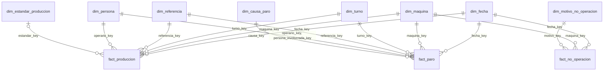

# Modelo dimensional

## Elección: esquema en estrella

Se elige una estrella porque el consumo principal son agregaciones por pocas dimensiones, y porque Power BI funciona mejor con relaciones directas entre hechos y dimensiones: las medidas DAX son más simples y los filtros se propagan sin rutas ambiguas. Un copo de nieve ahorraría poco espacio, ya que las dimensiones tienen menos de 1.500 filas, y añadiría uniones sin beneficio.

`dim_estandar_produccion` referencia a máquina y referencia, un pequeño rasgo de copo de nieve que se acepta porque el estándar depende de esa combinación y necesita historial propio. El consumo no lo necesita: las vistas ya incluyen la velocidad.

## Tablas de hechos y su grano

| Tabla | Grano | Tipo | Medidas | Filas |
|---|---|---|---|---|
| `fact_produccion` | Una línea de producción transcrita del formato: una fila de origen con pacas u horas | Transaccional | `pacas_reportadas`, `pacas_validas`, `unidades_producidas`, `horas_trabajadas` | 5.138 |
| `fact_paro` | Un código de paro con minutos dentro de una fila de origen | Transaccional | `minutos_paro` | 16.490 |
| `fact_no_operacion` | Una máquina, un día y un motivo de no operación | Instantánea periódica diaria | `horas_reportadas`, `horas_ajustadas` | 2.127 |

**Por qué tres hechos y no uno:** las tres medidas tienen granos distintos. Unirlas repetiría las pacas por cada paro de la línea, que es el error de doble conteo que hay que evitar. El tiempo no trabajado se reporta por día y no por turno, y por eso va aparte. Las medidas de distintos hechos se combinan en las vistas, agregando cada una por separado antes de unirlas.

`fact_produccion` no usa fecha, máquina, turno y referencia como clave, porque esa combinación se repite cuando una orden se parte en el turno. `fila_origen` es una dimensión degenerada que da unicidad y trazabilidad hasta la fila exacta del Excel.

## Dimensiones

| Dimensión | Atributos | Jerarquías | Origen |
|---|---|---|---|
| `dim_fecha` | Año, semestre, trimestre, mes, semana ISO, día, fin de semana | Año → semestre → trimestre → mes → día; año → semana → día | Generada |
| `dim_maquina` | Máquina, número de línea | - | Fuente |
| `dim_turno` | Turno, esquema, hora de inicio y fin, horas nominales | Esquema → turno | **Construida por el equipo** |
| `dim_referencia` | Referencia, familia, volumen, colores | Familia → referencia | Fuente, con atributos derivados del nombre |
| `dim_persona` | Seudónimo, rol | Rol → persona | Fuente, seudonimizada |
| `dim_causa_paro` | Código, área de impacto, clasificación OEE, si es falla, sistema, subcódigo | Clasificación → área → código → sistema → subcódigo | **Construida por el equipo** a partir de los catálogos |
| `dim_motivo_no_operacion` | Categoría, tipo, motivo | Categoría → tipo → motivo | **Construida por el equipo**: unifica dos catálogos |
| `dim_estandar_produccion` | Unidades por paca, unidades por minuto, origen, vigencia | - | Catálogo, con SCD tipo 2 |

Las dimensiones construidas agregan conocimiento que la fuente no tiene explícito: horarios y esquemas de turno; qué causas son programadas o fallas para el OEE; y las categorías que separan la no operación comercial de la operativa.

## Jerarquía código → subcódigo

Se **aplana en una sola dimensión** con una fila por hoja (`causa_nk`), en lugar de una tabla por nivel o una relación padre-hijo:

- **Profundidad fija y pequeña:** código → sistema → subcódigo.
- **Solo los códigos 01, 03 y 05 tienen detalle.** Los demás tienen una hoja "No aplica", y los paros de 01, 03 y 05 sin detalle van a "Sin especificar" dentro de su código. Así, todo paro tiene su clave y la suma de los hijos siempre coincide con su padre.
- **Drill-down directo en Power BI:** una jerarquía sobre columnas de una tabla no requiere DAX adicional para recorrer padres e hijos.
- **La fuente no permite otro grano:** cada código tiene como máximo un subcódigo por línea de origen, así que `fact_paro` se conecta a la hoja correcta sin necesitar una tabla puente.

El subcódigo se conserva en filas separadas por `Ingreso subcódigo`, por lo que varios subcódigos del mismo turno generan varias filas de `fact_paro`. La unicidad `(fila_origen, causa_key)` lo garantiza.

## Matriz de bus

| Proceso de negocio | Fecha | Máquina | Turno | Referencia | Persona | Causa de paro | Motivo de no operación | Estándar |
|---|---|---|---|---|---|---|---|---|
| Producción (`fact_produccion`) | X | X | X | X | X (operario) | | | X |
| Paros de línea (`fact_paro`) | X | X | X | X | X (operario, involucrada) | X | | |
| No operación (`fact_no_operacion`) | X | X | | | | | X | |
| Monitoreo hora a hora (Bloque 2) | X | X | X | X | | X | | X |

Fecha y máquina son las dimensiones conformadas que permiten cruzar los tres procesos; turno y referencia cruzan producción y paros.

## SCD: `dim_estandar_produccion`, tipo 2

**Por qué esta dimensión:** el estándar de velocidad cambia con el tiempo. El catálogo muestra `Vinilos_1` con 72 unidades/min en una tabla (`Tabla3`) y 86 en otra (`Tabla8`). Si se sobrescribiera (tipo 1), un cambio de velocidad alteraría el rendimiento y el OEE de meses ya reportados. Con el tipo 2, cada hecho conserva el estándar vigente cuando ocurrió.

**Implementación:** clave subrogada, `valido_desde`, `valido_hasta` y `es_vigente`, con `fact_produccion.estandar_key` apuntando a la versión exacta. Como la fuente no indica desde cuándo rige cada velocidad, hoy existe una sola versión por combinación (desde 2022 hasta 9999) y `Tabla3` no se carga. Cuando la velocidad cambie, el ETL cerrará la versión e insertará otra.

**Tipo 1 para las demás:** en `dim_referencia` y `dim_persona`, corregir un atributo no debe conservar historia.

## Restricciones e índices

Cada hecho tiene claves foráneas a sus dimensiones. Los `CHECK` impiden medidas negativas, `horas_ajustadas` mayor que `horas_reportadas` y códigos fuera de 1 a 18. Los `UNIQUE` de `fila_origen` y `(fila_origen, causa_key)` evitan cargar una línea dos veces.

| Índice | Consulta que justifica |
|---|---|
| `ix_produccion_fecha_maquina`, `ix_paro_fecha_maquina` | Filtros por periodo y máquina, los más frecuentes en ambos tableros |
| `ix_paro_grupo_oee` | Unión de producción y paro en `vw_oee_base` |
| `ix_paro_causa_fecha` | Pareto y tendencia por causa |
| `ix_produccion_maquina_turno` | Comparativo por turno |
| `ix_produccion_referencia`, `ix_produccion_operario` | Filtros por referencia y persona |
| `ix_no_operacion_motivo` | Análisis por motivo |
| `ix_causa_jerarquia` | Recorrido de la jerarquía de paros |

Se comprobó con `EXPLAIN` que un filtro de un mes y una máquina sobre `fact_paro` usa un `Index Scan`. Con este volumen, el planificador puede preferir recorrer la tabla cuando el filtro abarca muchos años.
