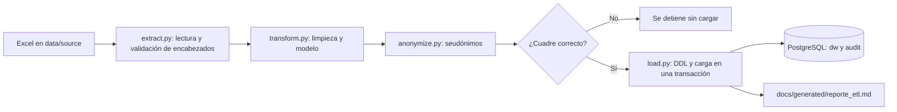

# Proceso ETL

## Herramienta: Python con pandas y openpyxl

- **Lee el `.xlsm` sin Excel ni macros**, por lo que funciona dentro de un contenedor Linux. Power Query dependería de una máquina Windows y no se puede lanzar con `docker compose up -d`.
- **Lógica versionable y con pruebas.** Las equivalencias y reglas son código revisable en Git, con pruebas automáticas en `etl/tests/`.
- **Datos personales fuera de la base.** La seudonimización ocurre antes de conectarse a PostgreSQL. Un enfoque ELT cargaría los nombres primero.
- **Volumen suficiente.** Con 8.208 filas, el proceso completo tarda menos de un minuto; no se necesita un motor distribuido.

## Flujo



1. **Extracción:** lee `Base De Datos` y las tablas de estándares. Si cambia una columna esperada, se detiene con un error claro.
2. **Limpieza:** aplica las reglas R01 a R26 y registra cuántas filas afecta cada una.
3. **Seudonimización:** reemplaza cada nombre por un HMAC-SHA256 con una sal secreta del `.env`. La misma persona conserva su seudónimo en cada recarga.
4. **Construcción del modelo:** convierte las 18 columnas de paro en filas y genera dimensiones y hechos.
5. **Cuadre:** compara fuente, exclusiones y cargado. Si la diferencia supera 0,01, se detiene sin tocar la base.
6. **Carga:** elimina y recrea los esquemas `dw` y `audit`, y carga todo en una sola transacción. Si algo falla, la versión anterior queda intacta.

## Decisiones de limpieza que requieren criterio

| Decisión | Alternativa descartada | Razón |
|---|---|---|
| Conservar las filas que solo tienen horas no trabajadas | Eliminarlas por estar casi vacías | Son el registro de días sin operación y de sus 40.466 h, el principal hallazgo |
| Conservar paros idénticos sin producción (R03) | Eliminarlos como duplicados | Dos paros iguales en un turno pueden ser dos eventos; borrarlos reduciría el tiempo de paro sin evidencia |
| Marcar las pacas imposibles sin borrarlas (R08) | Dividirlas o imputarlas | No se puede confirmar qué representan. El valor original queda en `pacas_reportadas` |
| Umbral de 100 pacas por hora | Un percentil | Separa dos grupos sin ambigüedad: el mayor valor aceptado es de 46,6 pacas/h y los 11 casos excluidos empiezan en 444 |
| Calcular rendimiento solo con referencia conocida | Imputar la referencia | Las unidades por paca varían de 48 a 720, así que imputar inventaría producción |
| Asignar `17. PARO DE MAQUINA` a "por ventas" | Mantenerlo aparte | Es el equivalente anterior de `[18] Paro de maquina` en el catálogo. **Es un supuesto**: pesa 18.498 h y conviene validarlo |
| No unir un nombre de pila suelto con un nombre completo | Unir todo lo parecido | Podría fusionar a dos personas. A cambio, una misma persona puede tener dos seudónimos |
| No cargar `Observaciones` (R14) | Limpiar nombres del texto libre | No se puede garantizar que un filtro elimine todos los nombres |

## Reproducir desde cero

```powershell
Copy-Item .env.example .env
# Editar .env y colocar el Excel en data/source/
docker compose up -d
docker compose logs -f etl
```

Pruebas automáticas, sin necesidad de la base:

```powershell
docker compose run --rm --no-deps etl python -m pytest tests -q
```

## Resultados

Los conteos, el cuadre y el efecto de cada regla de la última ejecución están en [`generated/reporte_etl.md`](generated/reporte_etl.md) y en las tablas `audit.conteo_filas`, `audit.cuadre_cifras` y `audit.calidad_datos`.

Cuadre comprobado:

| Métrica | Fuente | Excluido (R02) | Cargado | Diferencia |
|---|---|---|---|---|
| Pacas | 378.778,00 | 1.019,00 | 377.759,00 | 0,00 |
| Horas trabajadas | 38.063,35 | 129,00 | 37.934,35 | 0,00 |
| Minutos de paro | 506.979,10 | 859,00 | 506.120,10 | 0,00 |
| Horas no trabajadas | 41.519,85 | 120,00 | 41.399,85 | 0,00 |

Las pacas válidas son 52.493 menos que las cargadas (R08), y las horas no trabajadas ajustadas son 934 menos que las reportadas (R23). Esas diferencias son intencionales, y se pueden medir porque ambos valores quedan en la base.
