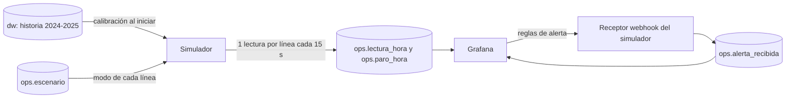

# Monitoreo casi en tiempo real: simulador, Grafana y alertas

## Qué resuelve

Los supervisores y el personal de mantenimiento necesitan ver cómo va cada línea **ahora** y enterarse cuando algo se sale de rango, sin esperar el informe mensual. La fuente histórica no sirve para eso: no tiene hora, solo turnos. Por eso la capa operativa funciona con lecturas hora a hora que un simulador genera a partir de la historia cargada.

## Cómo funciona la simulación

- **Una lectura es una hora de producción.** Cada 15 s reales llega la lectura de la hora siguiente para las cuatro líneas (`SIM_SEGUNDOS_POR_HORA`). El eje de tiempo de Grafana es el instante real de llegada, y `hora_simulada` guarda la hora que representa.
- **Calibración con la historia.** Al iniciar, el simulador lee `dw` desde `SIM_CALIBRACION_DESDE` (2024-01-01, cuando el OEE es confiable) y calcula para cada máquina: minutos de paro por hora trabajada de cada causa, las referencias que produce con su peso y velocidad estándar, y su rendimiento medio. Si se recarga el Excel, el simulador se recalibra solo.
- **Tamaño de los datos.** El esquema `ops` se purga a los 3 días y no depende de `dw`: el ETL recrea `dw` y `audit` en cada ejecución y `ops` sobrevive.

### Supuestos que deben declararse

| Supuesto | Valor | Por qué |
|---|---|---|
| Duración media de un evento de paro | 8 min; 25 min para fallas | La fuente solo trae minutos por código en cada línea, no eventos. La frecuencia se calcula para que los minutos por hora coincidan con la historia; la duración es una elección. |
| Variación del rendimiento por hora | Normal, desviación 0,10, entre 0,20 y 1,25 | El rendimiento de cada hora oscila alrededor del medio de la máquina. |
| Operación continua | 24 h todos los días | La simulación no modela horas sin programación. |
| Calidad | 100 % | La fuente no registra rechazos; el OEE mostrado es un máximo. |
| Modo `degradado` | Paros no programados × 2 y rendimiento × 0,85 | Sirve para mostrar un deterioro sin falla franca. |
| Modo `falla` | Una falla de código 01 o 03 de 30 a 55 min en cada hora | Sirve para provocar una alerta en la demostración. |

La variabilidad simulada es comparable a la real. En los turnos reales de 6 h o más desde 2024, la desviación de la disponibilidad es de 15,7 a 19,3 puntos y el 5 % peor de los turnos queda entre 37,6 % y 53,3 %. En la simulación, el 5 % peor de las ventanas de 4 h queda entre 48,6 % y 65,6 %: es algo menos ruidosa que la realidad, aun comparando una ventana más corta con turnos completos. Es un margen conservador para las falsas alarmas, pero conviene recordarlo al interpretar la tabla de umbrales.

## Tablero «Monitoreo de líneas de envasado»

Archivo: [`grafana/dashboards/monitoreo_lineas.json`](../grafana/dashboards/monitoreo_lineas.json). Se carga solo al iniciar Grafana y es la página de inicio.

| Panel | Pregunta que responde | Usuario |
|---|---|---|
| Estado de cada línea (repetido por máquina) | ¿Cómo va esta línea en las últimas 4 horas? Rojo por debajo del umbral de alerta. | Supervisión |
| Disponibilidad móvil de 4 horas | ¿Qué línea cae, y desde cuándo? Línea discontinua en 40 %. | Supervisión, mantenimiento |
| OEE móvil de 4 horas | ¿Cuál es el OEE actual frente a las metas de 75 % y 85 %? | Producción |
| Minutos de paro por clasificación | ¿Cuánto es programado y cuánto no? | Producción |
| Causas principales de paro no programado | ¿Qué causa pesa más ahora? Es el Pareto en tiempo real. | Mantenimiento |
| Unidades producidas por línea | ¿Cuánto produjo cada línea? | Producción |
| Última lectura por línea | Detalle de la hora más reciente y escenario de simulación. | Todos |
| Reglas de alerta y alertas entregadas | ¿Qué está disparado y a quién se avisó? | Mantenimiento |

**Variables del tablero:** `Máquina` y `Turno`, ambas de selección múltiple. Filtran todos los paneles (el estado repetido muestra una tarjeta por máquina elegida). El rango de tiempo y la actualización (5 s) son los habituales de Grafana.

Las cifras de «4 h» **suman minutos y unidades de las cuatro lecturas antes de dividir**, igual que el catálogo de indicadores. Promediar los porcentajes daría el mismo peso a una hora con 5 minutos operativos que a una con 55.

## Alertas

Se cargan por *provisioning* desde [`grafana/provisioning/alerting/alertas.yml`](../grafana/provisioning/alerting/alertas.yml). Cada regla se evalúa por máquina cada 10 s.

| Regla | Condición | Persistencia | Severidad | Para quién |
|---|---|---|---|---|
| **Disponibilidad baja** | Disponibilidad de las últimas 4 lecturas < 40 % | 30 s (2 lecturas) | crítica | Supervisión |
| **Falla electromecánica o de potencia** | Minutos de código 01 o 03 en la última lectura > 0 | inmediata | media | Mantenimiento |
| **Sin lecturas recientes** | Menos de 1 lectura en el último minuto, o sin datos | 30 s | crítica | Responsable del sistema |

La tercera existe porque un monitoreo sin datos no puede disparar ninguna otra alerta; también cubre la caída del simulador (o, en una planta real, del PLC).

### Por qué 40 % y por qué 2 lecturas seguidas

La disponibilidad por turno es muy variable: no se puede usar un umbral cercano al promedio (75 % a 84 % según la línea). Se evaluaron combinaciones de ventana, umbral y persistencia simulando 400 días por máquina en operación normal, y la detección de una falla sostenida:

| Ventana | Umbral | Lecturas seguidas | Falsas alarmas por 10 días y máquina (V1, V2, V3, V4) | Lecturas hasta detectar una falla |
|---|---|---|---|---|
| 4 h | 50 % | 2 | 2,4 · 4,0 · 0,4 · 0,2 | 3,2 |
| 4 h | 40 % | 1 | 1,6 · 2,8 · 0,3 · 0,1 | 2,7 |
| **4 h** | **40 %** | **2** | **0,4 · 0,9 · 0,1 · 0,0** | **3,7** |
| 4 h | 30 % | 2 | 0,1 · 0,1 · 0,0 · 0,0 | 4,4 |
| 8 h | 40 % | 2 | 0,0 · 0,1 · 0,0 · 0,0 | 5,9 |

Se eligió **4 h, 40 %, 2 lecturas**: menos de una falsa alarma cada 10 días en cualquier línea, con detección en unas 3,7 lecturas. Además, el umbral tiene respaldo histórico: entre enero de 2024 y marzo de 2025, solo el 3,8 % de los turnos de 6 h o más quedó por debajo de 40 % (2,4 % a 6,1 % según la línea). Es una desviación y no la operación habitual.

Una ventana de 4 h tarda varias horas en reaccionar ante una falla. Por eso existe la segunda regla, que avisa en la misma hora. En una planta real, con una lectura por hora, la misma lógica se evaluaría cada 10 min con persistencia de 2 h, sin cambiar umbrales.

### Entrega

El punto de contacto es un **webhook** hacia el simulador (`http://simulator:8080/alertas`), autenticado con un token del `.env`. El receptor guarda cada aviso, disparado y resuelto, en `ops.alerta_recibida`, y el tablero lo muestra. Así se demuestra la entrega completa sin depender de correo ni de servicios externos. En producción se cambiaría por correo, Teams o WhatsApp sin tocar las reglas.

## Demostración en vivo

1. `docker compose up -d` y abrir `http://localhost:3000` (Grafana ya tiene todo cargado).
2. En DBeaver, ejecutar el guion [`sql/queries/30_demo_escenarios.sql`](../sql/queries/30_demo_escenarios.sql) paso a paso:
   - `UPDATE ops.escenario SET modo = 'falla' WHERE maquina = 'Vinilos_2'`: en unos 15 s la regla «Falla electromecánica» se dispara y la disponibilidad móvil de Vinilos_2 cae; poco después «Disponibilidad baja» pasa de *Pending* a *Firing*.
   - Se registran los avisos en la tabla «Alertas entregadas».
   - `UPDATE ops.escenario SET modo = 'normal'`: las alertas se resuelven y quedan registradas.
3. Para un ritmo más lento, `SIM_SEGUNDOS_POR_HORA` en `.env` (por ejemplo 60).

## Validación realizada

Con la base cargada con el Excel real, se verificó: la carga automática de fuente de datos, tablero y reglas; que las ocho consultas del tablero y las dos variables se ejecutan sin error a través de la API de Grafana; y el ciclo completo con una falla provocada: reglas en *Normal*, paso a *Pending* y *Firing*, entrega al webhook, reparación y registro como resuelta.
