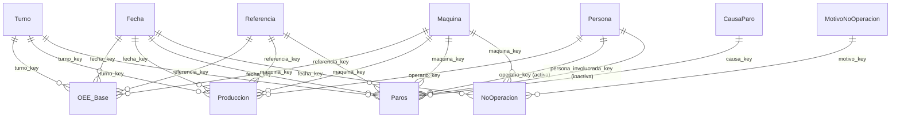

# Tablero analítico en Power BI

## Formato del proyecto: PBIP con TMDL y PBIR

El proyecto está en [`powerbi/`](../powerbi/) como **Power BI Project (`.pbip`)**, no como `.pbix`.

| | `.pbix` | **`.pbip` (elegido)** |
|---|---|---|
| Contenido | Un archivo binario comprimido | Carpetas de texto: modelo en **TMDL**, reporte en **PBIR** (un JSON por visual) |
| Diferencias en Git | Ilegibles: no se sabe qué cambió | Línea por línea: una medida DAX nueva aparece como una línea nueva |
| Trabajo de dos personas | Un cambio pisa al otro | Se fusionan ramas con cambios en archivos distintos |
| Datos | Incluye una copia de los datos | **No incluye datos ni credenciales**: se cargan al abrir |

Esto es lo que permite versionar el modelo sin subir los datos personales del Excel a un repositorio. El `.gitignore` excluye `*.pbix`, la caché del modelo y los ajustes locales.

## Cómo abrirlo

1. Levantar la solución (`docker compose up -d`) para que PostgreSQL esté en `localhost:5432`.
2. Abrir [`powerbi/BI_Envasado.pbip`](../powerbi/BI_Envasado.pbip) con Power BI Desktop.
3. Si pide un servidor distinto, editar los parámetros **Servidor** (`localhost:5432`) y **BaseDatos** (`bi_envasado`) en *Transformar datos → Administrar parámetros*.
   **Si el puerto 5432 está ocupado** por otro PostgreSQL del equipo (por ejemplo un servicio de Windows), Power BI llega a ese servidor y responde «No hemos podido autenticarle con las credenciales proporcionadas». Compruébelo con `Get-NetTCPConnection -LocalPort 5432 -State Listen` en PowerShell. La solución es poner otro puerto en `POSTGRES_PORT` del `.env` (por ejemplo 5434), ejecutar `docker compose up -d` y usar `localhost:5434` en el parámetro Servidor.
4. Al actualizar, elegir credenciales de **base de datos** con el usuario **`bi_lector`** y la clave `BI_READER_PASSWORD` del `.env`. No se guarda nada de esto en el proyecto. Si Desktop se queja del cifrado, desactivar «Cifrar conexiones»: el PostgreSQL local no tiene SSL.
5. Actualizar. Desde ahí el reporte lee de la base, **no del Excel**.

## Modelo semántico

Estrella con tres hechos y la vista `vw_oee_base`, que ya combina producción y paros al grano máquina-día-turno-referencia. El [catálogo de indicadores](02_catalogo_kpi.md) indica sumar sus tiempos antes de dividir, y por eso el OEE se calcula desde ella y no desde los hechos por separado.

- **19 relaciones**, todas de varios a uno y con filtro en un solo sentido, de la dimensión al hecho. Una sola, `Paros → Persona` por la persona involucrada, está **inactiva**: Power BI no admite dos relaciones activas entre las mismas tablas.
- **Tabla de fechas** marcada como tal (`Fecha[Fecha]`), con la fecha y hora automáticas desactivadas, para que la inteligencia de tiempo use el calendario del modelo.
- **Jerarquías:** de fecha (año → trimestre → mes → día); de paros (clasificación → área → código → sistema → subcódigo); de no operación (categoría → motivo); de turnos y de referencias.
- **Columnas ocultas** para las llaves y los minutos crudos, y `discourageImplicitMeasures` para que todo se calcule con medidas explícitas.
- **Columna calculada** `Fecha[Mes con registro de no operación]`, que marca los meses con al menos 30 filas de no operación: desde julio de 2024 casi no hay registro, y sin este filtro la utilización saldría cercana al 100 %.

### Medidas (33)

| Carpeta | Medidas | Idea clave |
|---|---|---|
| 1. Tiempos | Horas trabajadas, planificadas, operativas | Planificado = trabajado − paro programado; operativo = planificado − no programado. |
| 2. OEE | Disponibilidad, Rendimiento, Calidad (supuesto), **OEE**, Cobertura del rendimiento, **OEE confiable**, Productividad Excel | `DIVIDE(SUM(), SUM())`: se suma antes de dividir. «OEE confiable» solo muestra el valor desde 2024 y si la cobertura de la selección es de al menos 80 %; la inteligencia de tiempo se apoya en ella. |
| 3. Producción | Pacas válidas y reportadas, Unidades producidas, Unidades perdidas por paros no programados | Las pacas imposibles (R08) no suman a las válidas. |
| 4. Paros | Horas de paro, Horas de paro no programado, % del paro no programado, **Pareto % acumulado** | El acumulado ordena las causas por horas con `ADDCOLUMNS` sobre `ALLSELECTED`. |
| 5. Confiabilidad | Fallas, MTBF (h), MTTR (h) | Mismas definiciones que `vw_confiabilidad_mensual`. |
| 6. Capacidad | Horas no trabajadas, Horas trabajadas y no trabajadas (meses con registro), Utilización de capacidad | La utilización y las horas que la explican solo consideran meses con registro. |
| 7. Inteligencia de tiempo | **OEE año anterior** (`SAMEPERIODLASTYEAR`), Variación del OEE vs año anterior (pp), **OEE acumulado del año** (`DATESYTD`), **OEE móvil 3 meses** (`DATESINPERIOD`), Disponibilidad año anterior, Pacas año anterior, Pacas acumuladas del año, Variación de pacas | Todas calculan el cociente sobre el periodo desplazado, no el promedio de cocientes. |

Cada medida lleva su descripción en el modelo (`///` en TMDL), visible al pasar el cursor sobre ella en Desktop.

## Páginas del reporte

Todas tienen **navegación** (navegador de páginas arriba), **segmentaciones** de año, máquina y turno (sincronizadas entre páginas) y una nota con las salvedades del dato.

| Página | Pregunta | Qué contiene |
|---|---|---|
| **Resumen ejecutivo** | ¿Mejora o empeora el OEE? | Tarjetas de OEE, disponibilidad, rendimiento, horas y cobertura; OEE por mes frente al mismo mes del año anterior; OEE por máquina; OEE móvil de 3 meses. |
| **Causas de paro** | ¿Qué causas concentran las horas perdidas? | **Pareto** de paros no programados; barras con **profundización** área → código → sistema → subcódigo; matriz expandible; paro por máquina y área. |
| **Confiabilidad** | ¿Las fallas son menos frecuentes y más cortas? | Fallas, MTBF y MTTR por año y máquina, y las salvedades del dato. |
| **Capacidad** | ¿Cuánta capacidad queda sin usar y por qué? | Utilización, horas no trabajadas por motivo (con profundización), unidades perdidas. |
| **Calidad del dato** | ¿Desde cuándo se puede confiar en el OEE? | Cobertura del rendimiento por año y mes; pacas reportadas frente a válidas; comparación con el indicador de Excel. |

## Estado de la validación

- **Reporte (PBIR):** los 78 archivos JSON se validaron contra los esquemas oficiales de Microsoft (`visualContainer 2.4.0`, `report 3.0.0`, `page 2.0.0`) sin errores.
- **Modelo (TMDL):** la sintaxis se escribió siguiendo la documentación de TMDL y la lógica de las medidas replica la de las vistas SQL, que sí se ejecutaron contra los datos reales. **El modelo no se abrió en Power BI Desktop al generarlo.** Antes de la sustentación hay que abrirlo, actualizar y comprobar que las cifras coincidan con las de las consultas (por ejemplo, el OEE de 2024: Vinilos_3 81,6 %, Vinilos_4 79,6 %, Vinilos_2 60,8 %, Vinilos_1 55,9 %).

### Lista de comprobación al abrirlo

1. Desktop abre el proyecto sin mensajes de error de modelo.
2. Las 11 tablas cargan filas (`OEE_Base` debe tener 4.005 filas).
3. En Vista de modelo, hay 19 relaciones y la de persona involucrada aparece punteada.
4. El OEE confiable de 2024 por máquina coincide con las cifras de arriba.
5. «OEE año anterior» de 2025 devuelve el OEE de 2024 del mismo mes.
6. La jerarquía de paros se puede profundizar con las flechas del visual.
7. Los botones de navegación cambian de página y las segmentaciones se mantienen.
