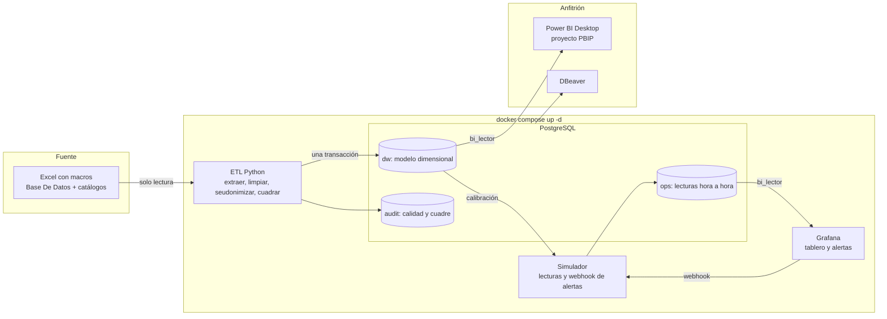
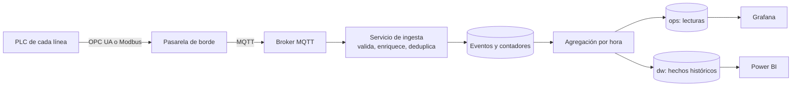

# Arquitectura, comparación de capas y evolución

## Arquitectura completa

| Componente | Tecnología | Por qué |
|---|---|---|
| ETL | Python con pandas y openpyxl | Lee el `.xlsm` sin Excel, corre en un contenedor Linux, es versionable y tiene pruebas. Detalle en [04_etl.md](04_etl.md). |
| Almacén | PostgreSQL 17 | Motor relacional con ventanas, vistas e índices; administrado desde DBeaver. |
| Esquemas | `dw`, `audit`, `ops` | `dw` y `audit` se recrean con cada ETL; `ops` sobrevive porque no depende de ellos. |
| Monitoreo | Grafana 12 con provisioning | Se levanta sin configuración manual. |
| Análisis | Power BI (PBIP) | Modelo semántico versionable en texto. |
| Orquestación | Docker Compose | Un solo comando, volúmenes para persistir, credenciales por variables de entorno. |

## Power BI y Grafana: no se intercambian

| | **Power BI** | **Grafana** |
|---|---|---|
| Pregunta que resuelve | ¿Mejora o empeora el OEE? ¿Qué causas de paro conviene atacar? ¿Dónde invertir? | ¿Cómo va cada línea ahora? ¿Cuál necesita atención en este momento? |
| Usuario | Alta dirección, jefatura de producción, planeación, coordinación de mantenimiento | Supervisión de turno y personal de mantenimiento |
| Horizonte | Meses y años: tendencias, comparativos, causas raíz | Horas y minutos: la ventana de las últimas horas |
| Actualización | Manual o programada (por ejemplo, tras cada carga mensual del Excel) | Cada 5 s en pantalla; una lectura nueva cada hora de producción |
| Fuente | `dw` (modelo dimensional, historia limpia y cuadrada) | `ops` (lecturas recientes) |
| Interacción | Exploración: segmentaciones, profundización, medidas con inteligencia de tiempo | Vigilancia: estado, umbrales y **alertas** que llegan sin que nadie mire |
| Forma de la medida | Se calcula bajo demanda sobre todo el historial | Ventanas móviles cortas, evaluadas continuamente |

**Por qué no se intercambian.** Power BI no está pensado para vigilar: no dispara alertas con persistencia por línea ni se refresca cada pocos segundos, y la dirección no necesita ver la hora a hora. Grafana no está pensado para analizar: no tiene modelo semántico ni medidas con inteligencia de tiempo, y el análisis de causas exige el historial completo con su jerarquía. Una capa sin la otra deja sin respuesta una de las dos necesidades de la dirección.

**Cómo se conectan.** Comparten las definiciones: ambas suman minutos y unidades antes de dividir, usan la misma clasificación de paros programados y no programados, y el Pareto de causas existe en las dos capas con la misma lógica (en Power BI sobre la historia; en Grafana sobre la ventana reciente).

## Evolución con datos directos de los PLC o el SCADA

Hoy la fuente es un formato en papel transcrito a Excel semanas después. Si los datos llegaran directamente de los PLC o el SCADA, cambiaría la **frecuencia, el grano y la confianza** del dato. El modelo y los tableros se conservan.

| Hoy | Con PLC o SCADA | Efecto |
|---|---|---|
| Minutos por código en cada turno | **Eventos de paro con inicio y fin** y código del operador en pantalla | MTBF y MTTR reales; hoy están sobrestimados porque varias fallas de una línea cuentan como una. |
| Pacas transcritas a mano (11 filas imposibles) | **Contadores de la máquina** por minuto | Desaparecen los errores de transcripción; el rendimiento deja de depender de un estándar con 47 % de las horas sin referencia. |
| Calidad supuesta en 100 % | Rechazos de la máquina, del sistema de visión o de la balanza | El OEE deja de ser un máximo y se puede calcular de verdad. |
| Referencia a mano (47 % de horas sin referencia) | Orden de producción desde el ERP o el MES | Rendimiento y OEE comparables en todo el periodo. |
| Lectura simulada por hora | Lectura real por hora (o por minuto, para el estado) | Las reglas de alerta se conservan; solo cambia la persistencia: cada 10 min y 2 h en lugar de 10 s y 30 s. |
| Operario por nombre | Credencial del operador | Seudonimización en origen; se evita que el nombre viaje. |

**Cambios en el modelo.** Se añade `fact_evento_paro` con grano «un evento» (inicio, fin, duración) y una dimensión de hora del día. `fact_paro` se mantiene para el histórico y se alimenta de los eventos agregados por turno, de modo que las vistas y las medidas de Power BI no cambian. La dimensión de estándares con SCD tipo 2 pasa a recibir sus versiones desde el MES, con fechas de vigencia reales.

**Cambios en la infraestructura.** Un broker MQTT y un servicio de ingesta que valide, deduplique y registre los datos en bruto; ahí se necesitaría una base de series de tiempo (por ejemplo TimescaleDB como extensión de PostgreSQL) y retención por capas. La red de la planta (OT) se separa de la de oficina (IT), y la pasarela de borde solo sale hacia el broker.

**Riesgos que hay que gobernar.** Latencia y pérdida de mensajes (cola con confirmación), relojes sin sincronizar (NTP en cada PLC), cambios de etiqueta en el PLC sin aviso (contrato de datos versionado) y seguridad de la red industrial. El control de calidad del dato (completitud, reglas de coherencia, cuadre) que hoy hace el ETL sobre el Excel pasa a ejecutarse de forma continua sobre el flujo.
